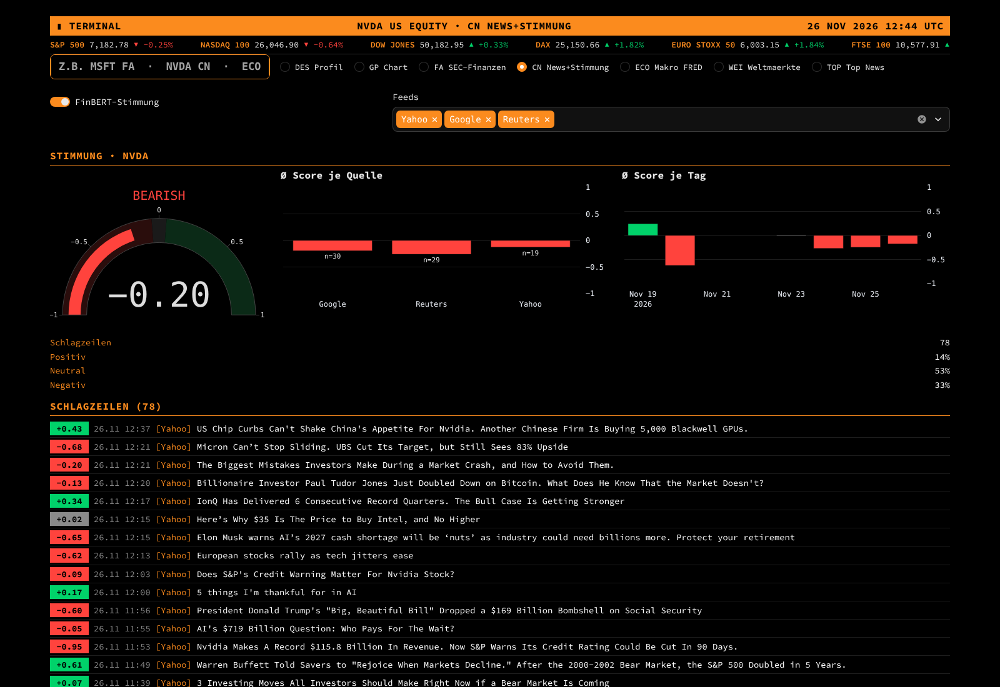

# Terminal – Finanzterminal im Bloomberg-Stil

Streamlit-App mit Befehlszeile und Funktionscodes, schwarz/orange wie ein Bloomberg-Terminal.

| Code | Funktion | Datenquelle |
|------|----------|-------------|
| `DES` | Profil, Kennzahlen, 1-Jahres-Chart, Beschreibung | Yahoo Finance (`yfinance`) |
| `GP`  | Kerzenchart, SMA 20/50/200, Volumen, RSI(14) | Yahoo Finance |
| `FA`  | GuV, Bilanz, Cashflow, Kennzahlen, letzte Filings (jährlich/quartalsweise) | SEC EDGAR XBRL (`companyfacts`, `submissions`) |
| `CN`  | Unternehmensnachrichten mit Stimmungsbewertung | Yahoo Finance RSS, Google News RSS, Reuters (via Google News) + **FinBERT** |
| `TOP` | Allgemeine Marktnachrichten mit Stimmung | wie `CN` |
| `ECO` | 16 Makroindikatoren, Snapshot-Tabelle, US-Zinsstrukturkurve | FRED |
| `WEI` | Weltmärkte: Indizes, FX, Rohstoffe, Krypto | Yahoo Finance |

Eingabe in der Befehlszeile: `NVDA CN`, `MSFT FA`, `AAPL US EQUITY GP <GO>`, `ECO` – Enter.



## Start

```bash
pip install -r requirements.txt
streamlit run streamlit_app.py
```

Beim ersten Aufruf von `CN`/`TOP` lädt `transformers` das Modell `ProsusAI/finbert` (~440 MB) von Hugging Face.

### Online (Streamlit Community Cloud)

Die App wird von Streamlit Community Cloud aus dem Branch `main` dieses Repos gestartet
(Main file `streamlit_app.py`). Jeder Push auf `main` aktualisiert sie automatisch.
`SEC_USER_AGENT` kann in den App-Einstellungen unter **Secrets** gesetzt werden.

### Optionale Umgebungsvariablen

| Variable | Zweck |
|----------|-------|
| `SEC_USER_AGENT` | Die SEC verlangt einen User-Agent mit Kontakt, z. B. `"Max Muster max@example.com"`. Bitte setzen. |
| `FRED_API_KEY` | Nutzt die offizielle FRED-API statt des öffentlichen CSV-Exports. |

## Hinweise

* **Reuters** bietet seit 2020 keine öffentlichen RSS-Feeds mehr. Reuters-Schlagzeilen kommen über die Google-News-Suche mit `site:reuters.com`.
* **Stimmungsscore** = P(positiv) − P(negativ) laut FinBERT, Bereich −1 … +1. Bewertet wird nur die Schlagzeile, nicht der Artikel.
* **Quartalswerte in FA:** Q4 steht nur im 10-K und wird als Geschäftsjahr minus Q1–Q3 abgeleitet.
* `FA` funktioniert nur für Unternehmen, die bei der SEC berichten (US-Emittenten und ADRs mit 20-F; IFRS-Tags werden mitgelesen).
* Yahoo-Kurse können verzögert sein. Kein Anlagerat.

## Struktur

```
streamlit_app.py       Streamlit-Oberfläche (Befehlszeile, Funktionsseiten)
terminal/market.py     yfinance: Kurse, Stammdaten, Marktmonitor, RSI/SMA
terminal/sec.py        SEC EDGAR: CIK-Lookup, XBRL-Abschlüsse, Kennzahlen, Filings
terminal/fred.py       FRED: Reihen, YoY-Transformation, Zinskurve
terminal/news.py       RSS-Feeds Yahoo / Google News / Reuters, Deduplizierung
terminal/sentiment.py  FinBERT-Pipeline und Aggregation
tests/                 Offline-Tests (python -m pytest tests)
```
